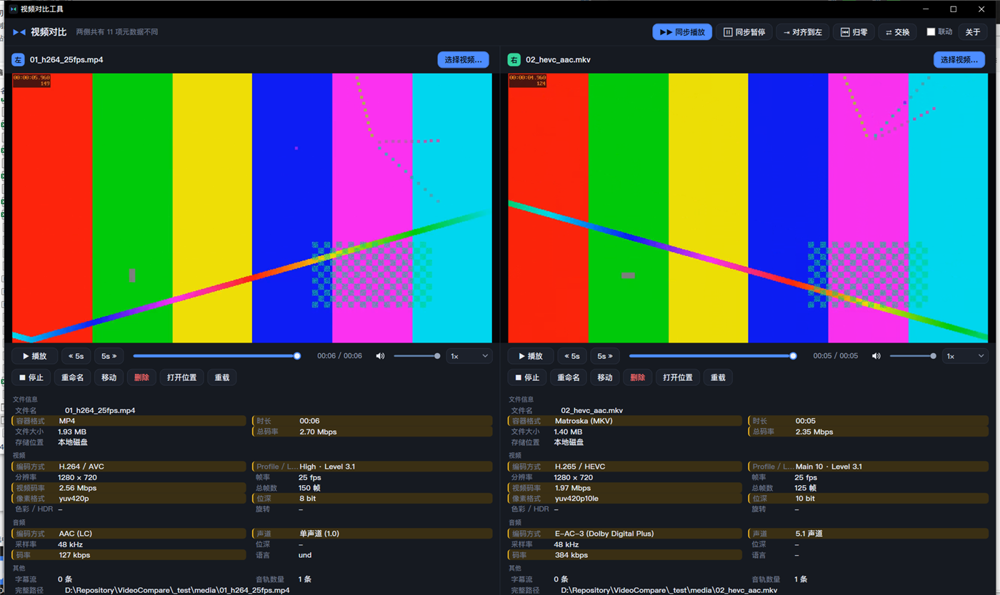

# 视频对比工具 · VideoCompare

左右两栏同时播放两个不同的视频，逐项对照编码方式、分辨率、帧率、位深、声道、码率等元数据，
并用**按钮**完成重命名 / 移动 / 删除等文件操作。原生 Windows 桌面程序（WPF / .NET Framework 4.x），
单文件 exe，绿色免安装。



## 功能

| 区域 | 能力 |
| --- | --- |
| 双栏播放 | 左右各一个独立播放器，可同时播放不同文件；「同步播放 / 同步暂停 / 对齐到左 / 归零」一键对齐两侧 |
| 元数据对照 | 容器、编码方式、分辨率、帧率、位深、编码档次、声道数、声道布局、采样率、码率、时长、文件大小、路径……值不同的行用琥珀色高亮 |
| 操作按钮 | 每栏的 **重命名 / 移动 / 删除 / 打开位置** 全走按钮，重命名与移动有输入框和目录选择器，删除本地文件进回收站、网络文件永久删除 |
| 拖放 | 直接把文件从资源管理器拖到任一栏的播放区 |
| 网络大文件 | `\\NAS\share\a.mkv` 这类 UNC 路径可直接打开；定位 20+ GB 的 4K 文件时进度条刻度优先，未被缓冲也会先钉住目标再等画面 |
| 深色界面 | 自绘进度条 / 音量条 / 滚动条 / 倍速下拉，深色标题栏 |
| 其他 | 音量与静音（左右联动）、倍速、帧预览、停止（释放文件占用）、缓存上限与清理、崩溃日志、「关于」对话框 |

## 下载与运行

1. 从 [Releases](https://github.com/FASUZO/VideoCompare/releases) 下载 `video-compare-<版本>-win-x64.zip`；
2. 解压，双击 `VideoCompare.exe`（窗口标题为「视频对比工具」）；
3. 首次启动会弹一次使用提示。

系统要求：Windows 10 / 11 x64。程序是 .NET Framework 4.x 应用，Win10 及以上自带运行时，无需安装。

也可以把两个文件直接拖到 exe 上启动：`VideoCompare.exe a.mp4 b.mkv`。

## 依赖说明（重要）

程序用的是 **Windows 自带的 Media Foundation** 解码，本身不带解码器：

- H.264 / MP4 / MOV、MP3、AAC、WMA 等通常开箱可用；
- **HEVC(H.265)、VP9、AV1、MKV 的播放取决于系统装了什么**。HEVC 一般需要装微软商店的
  「HEVC 视频扩展 / HEVC Video Extensions」；MKV 需要系统有对应的分离器（如装了播放器套件后）。
- 打不开时程序会给出两条兜底：**转封装**（remux 到 MP4）和**转码片段**（把当前位置前后 60 秒转成 H.264）。
  这两条都依赖 ffmpeg。

### 可选的 ffmpeg

把 ffmpeg 放到以下任一位置，程序会自动找到（**本仓库不分发 ffmpeg**）：

```
<程序目录>\ffmpeg\bin\ffmpeg.exe        ← 便携部署推荐
%LOCALAPPDATA%\VideoCompare\ffmpeg\bin\ffmpeg.exe
PATH 里的 ffmpeg.exe
```

ffmpeg 用途：探测精确元数据（ffprobe）、兜底转封装/转码、为不支持的编码生成播放片段。
请自行下载官方构建：<https://www.gyan.dev/ffmpeg/builds/> 或 <https://github.com/BtbN/FFmpeg-Builds/releases>。
注意 GPL 构建的分发约束，见 [LICENSE](LICENSE) 末尾说明。

## 构建

```powershell
# 只用 Windows 自带的 C# 编译器，不需要 Visual Studio / MSBuild / NuGet
powershell -ExecutionPolicy Bypass -File build.ps1          # 产出 dist\VideoCompare.exe
powershell -ExecutionPolicy Bypass -File build.ps1 -Zip     # 额外打包 release zip
```

也可以直接用 MSBuild / Visual Studio 打开 `src/VideoCompare/VideoCompare.csproj`（目标 .NET Framework 4.8，
用 VS 构建时需要装 4.8 的目标包；只用 `build.ps1` 则不需要，警告 `MSB3644` 可忽略）。
产物为单文件 exe（约 200 KB），运行时资源（XAML 样式）以字符串形式内嵌，见 `src/VideoCompare/Styles.cs`。

## 自动化测试

程序自带几个无界面自检开关，结果写在 exe 同目录的 txt 里，可直接用于 CI：

```powershell
# 生成测试样片（需要 ffmpeg 在 PATH）
powershell -ExecutionPolicy Bypass -File _test/make_media.ps1

# 元数据 + 解码能力自检（两栏各载入一个文件，检查时长/分辨率/能否播放）
dist\VideoCompare.exe --selftest "_test\media\01_h264_25fps.mp4" "_test\media\02_hevc_aac.mkv"

# 界面控件自检（样式是否生效、双列信息区、静音、缓存）
dist\VideoCompare.exe --uicheck "_test\media\01_h264_25fps.mp4" "_test\media\03_prores422.mov"

# 进度条定位稳定性（不会「点了又弹回原刻度」）
dist\VideoCompare.exe --seektest "_test\media\07_long_90s.mp4" "0.2,0.85,0.05,0.6,0.35,0.9,0.45"

# 模拟真实点击（含「点到空白处」）的快速连点测试
dist\VideoCompare.exe --clicktest "_test\media\07_long_90s.mp4" "0.9,0.1,0.9,0.1,0.5,0.95,0.05" 350
```

每个开关最后一行输出 `RESULT_OK` 或 `RESULT_FAIL`。CI 见 `.github/workflows/build.yml`。

## 数据与日志

配置、崩溃日志、转码缓存都放在用户目录，不污染程序目录：

```
%LOCALAPPDATA%\VideoCompare\settings.ini    窗口位置/音量/静音/联动/上次目录/缓存上限
%LOCALAPPDATA%\VideoCompare\logs\          崩溃日志 crash-*.log
%LOCALAPPDATA%\VideoCompare\cache\         转码片段缓存（默认上限 2048 MB，启动时自动淘汰）
```

「关于」对话框里可以查看这些路径、清空缓存、直接打开日志目录。

## 常见问题

**Windows 提示「Windows 已保护你的电脑」**
exe 没有代码签名证书，SmartScreen 会拦。点「更多信息 → 仍要运行」，或在文件属性里勾选「解除锁定」。
校验完整性请对比 Release 页面给出的 SHA-256。

**打开某些视频只有声音、没有画面**
系统缺对应解码器，见上文「依赖说明」；在「关于」里确认是否找到了 ffmpeg。

**删除时提示文件被占用**
先点该栏的「停止」（程序会关闭播放器与流），再删除。正在播放的文件会被系统锁住。

**窗口太小 / 信息区还是出现滚动条**
信息区按内容自适应，超长路径用省略号并在悬停时给出完整提示；把窗口拉大即可。

## 旧版（web 界面）

`legacy/` 里是早期用 Python + 浏览器做的版本（本地 HTTP 服务 + 内嵌网页），已被原生 GUI 取代，
仅作参考保留，不再维护。其中 `legacy/packaging-attempts/` 是当时的单文件打包尝试。

## 许可

代码以 [MIT](LICENSE) 发布。程序不使用也不分发 ffmpeg；若你随程序一起分发 ffmpeg（GPL 构建），
需要自行遵守其许可证要求。
